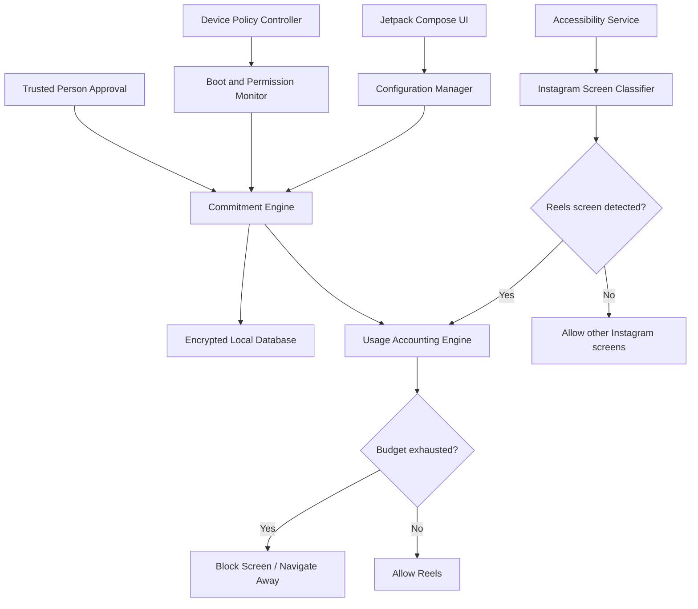
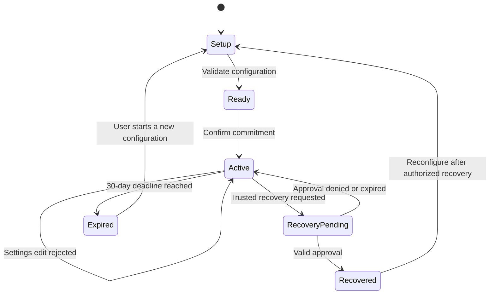
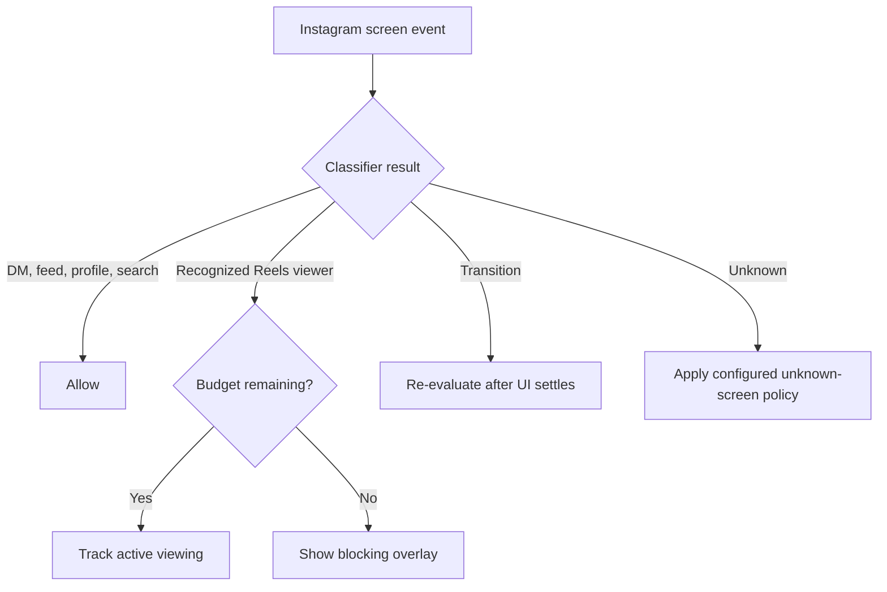
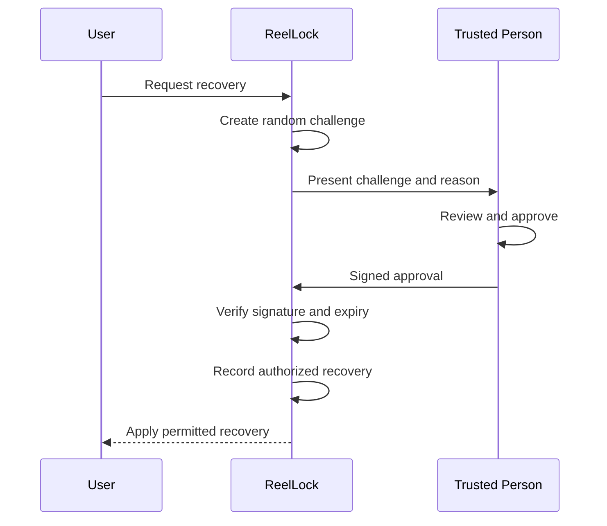

# ReelLock: Technical Specification & Implementation Plan

Android · Kotlin · Local-first · Tamper-resistant digital wellbeing

## 1. Product objective

ReelLock is an Android application that helps you limit Instagram Reels consumption without blocking the rest of Instagram.

The core principle is commit before temptation: configure your limits, activate the commitment, and prevent changes to those limits for 30 days. A trusted person controls recovery if you genuinely need an exception.

## ReelLock

Active commitment profile

Specification

Reels allowance

# 30 minutes

Per rolling 5-hour window

Configuration lock

# 30 days

From activation

Allowed after the Reels budget expires

Direct messages and inbox

Feed posts and profiles

Search and other non-Reels features, where detectable

Recovery requires trusted-person approval

No ordinary self-service unlock during the commitment period.

Important engineering constraint: Instagram is a third-party app with encrypted network traffic and a frequently changing interface. ReelLock cannot guarantee perfect separation between Reels and every other Instagram surface. The implementation must detect and block Reels at the UI level, test false positives, and disclose where detection can fail. Android device-management policies can strengthen protection, but do not magically make a personally owned phone impossible for its owner to modify.

## 2. Requirements and scope

| ID  | Requirement                  | Acceptance criteria                                                                              |
| --- | ---------------------------- | ------------------------------------------------------------------------------------------------ |
| R1  | Configurable limits          | Allowance and window are editable before activation.                                             |
| R2  | Rolling usage budget         | At most 30 minutes of detected Reels usage in any rolling 5-hour interval.                       |
| R3  | Monthly commitment           | Protected settings cannot be changed through the app for 30 days after activation.               |
| R4  | Feature selectivity          | DMs, feed, profiles and search remain accessible in tested Instagram versions.                   |
| R5  | Trusted recovery             | A separately authenticated trusted person must authorize recovery.                               |
| R6  | Persistence                  | Usage and lock deadlines survive app process death and device reboot.                            |
| R7  | Clock resistance             | Manual clock changes do not directly reset usage or shorten the commitment.                      |
| R8  | Device-management support    | Use device-owner policies where the device is provisioned to support them.                       |
| R9  | Transparent failure handling | Loss of permissions or detection confidence is reported instead of silently claiming protection. |
| R10 | Local-first operation        | Core usage accounting and enforcement work without a backend or internet connection.             |

### Explicit non-goals

- Blocking all Instagram traffic at the network layer.
- Reading private messages or collecting message content.
- Modifying Instagram APKs or bypassing its application security.
- Guaranteeing that no technically capable owner can disable the app.
- Using accessibility to monitor unrelated applications unnecessarily.

## 3. Recommended architecture

Use a modular Kotlin application with a small, independently testable enforcement core. The user interface should never be responsible for deciding whether the commitment has expired.





### Module responsibilities

| Module          | Responsibility                                                                        |
| --------------- | ------------------------------------------------------------------------------------- |
| `ui`            | Setup wizard, usage dashboard, commitment status and recovery screens.                |
| `config`        | Validation, versioning and activation of user-selected rules.                         |
| `commitment`    | Enforce the 30-day configuration lock.                                                |
| `accessibility` | Detect Instagram foreground transitions and inspect relevant UI nodes.                |
| `classifier`    | Determine whether the current screen is a Reels viewer, feed, DM, profile or unknown. |
| `usage`         | Track Reels viewing sessions and calculate the remaining budget.                      |
| `enforcement`   | Show the block screen, navigate away when necessary and report failures.              |
| `persistence`   | Store configuration, usage intervals, recovery state and audit events.                |
| `deviceadmin`   | Apply supported Android device policies when properly provisioned.                    |
| `recovery`      | Verify approval signed by the trusted person's key.                                   |
| `monitoring`    | Check service availability, reboot recovery and permission status.                    |

Recommended stack:

- Kotlin and Jetpack Compose
- Room with SQLite for structured persistence
- Android Keystore for cryptographic key protection
- Android `AccessibilityService` for UI detection
- `DevicePolicyManager` for supported device-owner controls
- WorkManager for deferred maintenance and consistency checks, not precise enforcement timing
- A minimal backend only if you want remote trusted-person approvals

The Android documentation describes accessibility services as user-enabled system services that receive interface events. The service can be disabled in system settings, so permission monitoring is essential.&#x20;

[image](https://www.google.com/s2/favicons?domain=https://developer.android.google.cn\&sz=32)

Android Developers

+1


## 4. Configuration model

All configuration options should be editable before activation. Activation creates a versioned, immutable commitment snapshot.

A possible configuration model:

```
data class CommitmentConfig(
    val version: Int,
    val reelsAllowanceSeconds: Long,
    val windowSeconds: Long,
    val commitmentDays: Int,
    val recoveryMode: RecoveryMode,
    val enforcementMode: EnforcementMode,
    val targetPackage: String,
    val blockUnknownScreens: Boolean,
    val allowRecoveryDuringLock: Boolean
)

enum class RecoveryMode {
    TRUSTED_PERSON
}

enum class EnforcementMode {
    ACCESSIBILITY,
    DEVICE_MANAGED
}
```

This is a starting data model, not the complete security boundary. The app must validate every field, enforce supported ranges, and prevent the UI from directly modifying an active configuration.

For the initial profile:

- `reelsAllowanceSeconds`: 1,800
- `windowSeconds`: 18,000
- `commitmentDays`: 30
- `recoveryMode`: `TRUSTED_PERSON`
- `enforcementMode`: device-managed where genuinely available, otherwise accessibility-based with an explicit reduced-protection warning

The app should support other values in its setup UI without requiring a new release.

### Configuration state machine





A recovery event must not silently erase the usage history. Record the recovery reason, approver, timestamp and affected configuration version.

Security invariant: no ordinary settings operation can change the active allowance, window duration, commitment deadline or recovery policy before the commitment expires.

The only exception is a separately authorized recovery path, which should be visible in the audit history.

## 5. Reels detection and selective blocking

This is the hardest technical component, not the settings screen.

### Detection strategy

Use an explicit state machine with four outcomes:

- `NON_REELS`: a recognized feed, DM, profile or search screen.
- `REELS`: a recognized Reels viewer.
- `TRANSITION`: navigation or loading is in progress.
- `UNKNOWN`: the current screen cannot be classified confidently.

Detection should combine:

1. Instagram's package name and foreground-window events.
2. Accessibility node hierarchy, visible labels and view structure.
3. Navigation-state changes and screen transitions.
4. A maintained set of detection rules, tested against supported Instagram versions.

Do not rely exclusively on labels such as “Reels”. A video can appear in the feed, and Instagram may change its interface without changing the package name.

### Blocking decision




For a recognized Reels screen, the enforcement service should show an accessibility overlay or navigate away when the budget is exhausted. The overlay should display the remaining commitment period and explain that recovery requires the trusted person.

Avoid blanket blocking of video playback. That would likely break ordinary feed videos too. Instead, use conservative detection rules and explicitly test false positives.

The service should request only the event types and window access it needs. Android documents that accessibility services can inspect interface nodes, but their availability and lifecycle are controlled by the system.&#x20;

[image](https://www.google.com/s2/favicons?domain=https://developer.android.google.cn\&sz=32)

Android Developers

+1


### Usage accounting algorithm

For a rolling five-hour window, track the actual intervals during which a recognized Reels viewer is visible and active.

Suppose the current time is \\(t\\), and the window length is \\(W=18{,}000\\) seconds. For each recorded viewing interval, calculate how much overlaps the interval from \\(t-W\\) to \\(t\\).

The budget is:

\\[ \text{remaining}(t)= \max\left(0,\ 1800-\text{usage}(t-18000,t)\right) \\]

When the sum reaches 1,800 seconds, block further Reels viewing until enough old usage falls outside the rolling window.

Implementation requirements:

- Count only time during which the Reels viewer is actually in the foreground.
- Stop the interval when the screen changes, Instagram leaves the foreground, or the device locks.
- Persist interval start/end records so process death doesn't reset the allowance.
- Reconcile an unfinished session on restart.
- Never count time spent in DMs or normal feed screens as Reels usage.
- Treat uncertain intervals conservatively and show an indicator when detection confidence is low.

There is a practical limitation: Android accessibility events are not a guaranteed, high-frequency clock. If the system suspends the service or a screen cannot be recognized, the app cannot know the true viewing duration perfectly. Test this on the actual target phone before relying on it.

## 6. Thirty-day configuration lock

Use a separate commitment engine with an immutable activation record.

The configuration lifecycle is:

1. Validate all settings.
2. Show a summary of the rules and recovery arrangement.
3. Require explicit confirmation.
4. Save the configuration snapshot and activation record transactionally.
5. Disable configuration changes until the deadline.
6. Permit changes only after expiry or verified recovery.

Suggested database entities:

| Entity             | Important fields                                                      |
| ------------------ | --------------------------------------------------------------------- |
| `ActiveCommitment` | `configVersion`, `activatedAt`, `deadline`, `status`                  |
| `CommitmentConfig` | Allowance, window, recovery mode, enforcement settings                |
| `UsageInterval`    | Start/end monotonic times, boot identifier, classification confidence |
| `RecoveryRequest`  | Nonce, reason, creation time, status, expiry                          |
| `RecoveryApproval` | Approver ID, signed challenge, approval timestamp                     |
| `SecurityEvent`    | Event type, timestamp, config version, outcome                        |

Use a database transaction to activate the commitment and store its initial configuration. All configuration mutation APIs should check the commitment engine, not just whether the UI is editable.

For example:

```
suspend fun updateConfig(
    requested: CommitmentConfig,
    now: TrustedTime
): UpdateResult {
    val active = repository.getActiveCommitment()
        ?: return UpdateResult.NoActiveCommitment

    if (now < active.deadline && !active.authorizedRecovery) {
        return UpdateResult.Locked
    }

    validator.validate(requested)
    repository.saveDraft(requested)

    return UpdateResult.Updated
}
```

This is illustrative application logic, not a tamper-proof security boundary. A malicious modification of a normal app's process or local storage could bypass checks implemented only in that app.

### Timing and clock manipulation

Android provides `SystemClock.elapsedRealtime()`, a monotonic clock that includes deep sleep and is not affected by ordinary wall-clock changes. It is suitable for measuring durations. However, its value resets across reboots. `System.currentTimeMillis()` survives reboots as a timestamp source, but the user or system can change it.&#x20;

[image](https://www.google.com/s2/favicons?domain=https://developer.android.com\&sz=32)

Android Developers

+1


Use separate strategies for separate jobs:

- Usage duration: monotonic elapsed time, anchored to a boot session.
- Commitment deadline: a trusted timestamp, preferably confirmed by a trusted-person service or another authenticated time source.
- Offline operation: persist the last trusted timestamp and boot metadata, detect inconsistent clock changes, and refuse to grant extra allowance merely because the wall clock moved backwards.

Without a trusted external time source, a fully offline app cannot robustly distinguish every legitimate reboot and clock correction from deliberate manipulation. It must choose a conservative fallback, such as freezing configuration changes until the trusted person revalidates the commitment.

## 7. Trusted-person recovery

A locally stored PIN alone is not sufficient protection. The phone owner may be able to clear app data, reinstall the app, or extract application data on a compromised device.

Use a cryptographic approval flow instead.




### Recommended security model

- The trusted person creates a public/private key pair on their own device.
- ReelLock stores the trusted person's public key.
- A recovery request contains a random nonce, device identifier, commitment version, requested action and expiry.
- The trusted person signs the exact request.
- ReelLock verifies the signature, nonce, expiry and commitment version.
- The approval is single-use and recorded in the audit history.

Use a backend if approval needs to happen remotely. For a completely offline design, the trusted person must sign a challenge on a separate device and transfer the signed response, for example by QR code.

Recovery should have narrowly defined powers. Ideally, it authorizes a specific action rather than giving the trusted person unrestricted access to every setting. Every approval should be explicit and auditable.

## 8. Strict Android device management

This needs a distinction between an app that requests special permissions and a real Android device policy controller.

### Device-owner mode

Android supports device-owner provisioning for managed devices. A device owner can enforce certain system-wide policies, including restrictions on uninstalling applications and entering Safe Mode where supported. But device-owner status is established through device provisioning, generally during initial device setup, rather than by an ordinary app granting itself privileges later.&#x20;

[image](https://www.google.com/s2/favicons?domain=https://developer.android.google.cn\&sz=32)

Android Developers

+2


For ReelLock, implement two operating modes.

Managed mode

The app is provisioned as an appropriate device policy controller. Apply only supported policies that protect ReelLock and preserve the intended user experience. Test policy conflicts and provide a documented administrator recovery path.

Standard mode

The app uses accessibility monitoring, persistent storage and trusted-person recovery. It can detect some permission loss and discourage bypasses, but cannot prevent every uninstall or settings change.

Do not silently label standard mode as strict. Show which protections are actually active.

### Important trade-off

Device-owner restrictions are designed for managed devices, not just for locking one feature in a personal app. They can affect app installation, system settings and device recovery. Provisioning may require a fresh device setup, and recovery from misconfiguration must be planned before enabling restrictive policies.

If your phone is already set up and you don't want to factory-reset it, begin with standard mode. Do not factory-reset your phone solely to experiment with device-owner provisioning without understanding the consequences.

## 9. Persistence, reboot and tamper resistance

The goal is to preserve the commitment even when the app process dies, the phone restarts, or network connectivity changes.

| Threat or action                       | Mitigation                                                                             | Remaining limitation                                               |
| -------------------------------------- | -------------------------------------------------------------------------------------- | ------------------------------------------------------------------ |
| Change Wi-Fi or mobile data            | Enforcement runs locally; no dependency on network filtering                           | No effect on UI-classifier weaknesses                              |
| Kill ReelLock process                  | Persist state immediately; recover and reconcile sessions on restart                   | Android may delay background execution                             |
| Restart phone                          | Restore database state and recheck permissions on boot                                 | Monotonic time resets at reboot                                    |
| Change system clock                    | Detect time changes and validate against trusted time                                  | Offline wall-clock manipulation cannot be perfectly ruled out      |
| Clear app data                         | Use device-management controls where available and remote commitment records if needed | Standard mode can lose local records                               |
| Uninstall ReelLock                     | Device-owner uninstall restrictions where supported                                    | Standard mode cannot prevent removal                               |
| Disable accessibility                  | Monitor permission state and report protection loss                                    | Standard mode cannot stop the user from revoking access            |
| Enter Safe Mode                        | Apply supported managed-device restrictions                                            | Availability and effectiveness depend on device policy             |
| Root or modify the OS                  | Treat integrity as compromised; use trusted recovery                                   | A compromised device can defeat application-level controls         |
| Reinstall Instagram or change networks | Reapply detection to the installed target package                                      | Alternate Instagram clients and browsers require separate policies |

### Boot recovery sequence

1. Receive the boot event where permitted and schedule recovery work.
2. Load the active commitment and the latest durable usage checkpoint.
3. Reconcile the last recorded Reels session without counting the entire downtime as viewing.
4. Compare wall-clock time, boot metadata and the last trusted timestamp.
5. Revalidate device-management and accessibility permissions.
6. Resume enforcement or enter a clearly marked degraded-protection state.

WorkManager is appropriate for deferred recovery tasks, but it should not be the primary mechanism for instant Reels blocking.

### Integrity and local storage

Use Android Keystore for cryptographic keys and authenticated encryption for sensitive local state. However, encrypting the database doesn't by itself prevent its owner from clearing the data. A local signature can detect certain changes, but if both the data and the signing authority are controlled by the same compromised app environment, it is not an absolute guarantee.

For a stronger commitment model, keep the trusted person's signing key outside the phone. The recovery authority should validate the commitment version and deadline independently.

## 10. Permissions and privacy

Keep the permissions surface narrow.

| Capability                                    | Purpose                                                             |
| --------------------------------------------- | ------------------------------------------------------------------- |
| Accessibility service                         | Detect relevant Instagram screens and enforce the Reels block       |
| Boot receiver                                 | Restore enforcement after device startup                            |
| Foreground service, where justified           | Maintain user-visible monitoring on supported Android versions      |
| Device admin / device-owner provisioning      | Apply only the device policies that the provisioned role permits    |
| Network access, if remote recovery is enabled | Deliver a recovery challenge and validate an authenticated response |

Avoid requesting broad access to all installed applications when targeting Instagram alone is sufficient. Avoid VPN permissions, contacts, SMS, microphone and notification-reading access unless a separate, justified feature actually requires them.

Distribution warning: Google Play has specific disclosure and declaration requirements for Accessibility API usage. It distinguishes accessibility tools for people with disabilities from other apps that use accessibility for automation. ReelLock must not falsely declare itself an accessibility tool, and its proposed usage needs to comply with the current Play policy before publication.&#x20;

[image](https://www.google.com/s2/favicons?domain=https://support.google.com\&sz=32)

Play Console Help

+1


For a personal prototype, first validate the approach on your own device and review the distribution requirements before planning a public release.

## 11. Testing and acceptance criteria

Treat enforcement correctness as more important than visual polish.

### Functional tests

0 of 13 test criteria reviewed

Reset

Configuration can be changed before activation.

Activation creates a fixed 30-day commitment.

Editing allowance and window settings is rejected while locked.

Thirty minutes of detected Reels viewing exhausts the budget.

Usage is calculated over a rolling five-hour window.

Instagram DMs remain usable after the Reels budget is exhausted.

Feed posts, profiles and search remain usable in the tested Instagram version.

Usage state survives process death and reboot.

Changing the network does not reset usage.

Manual clock changes do not automatically unlock settings.

Trusted-person recovery rejects invalid, expired and replayed approvals.

Permission loss is visible and produces a protection warning.

Unknown Instagram screens follow the configured policy.

Additional testing should cover:

- At least two supported Android versions and the actual target phone.
- Instagram UI changes, orientation changes, split-screen and picture-in-picture.
- Rapid navigation between Reels, feed and DMs.
- Screen locking while a Reels session is active.
- Battery optimization and aggressive background-process management.
- Recovery while offline and after the trusted person's key is rotated.
- App update, database migration, reinstall and permission revocation.
- False-positive rate for normal feed videos.

Do not ship with a claim of perfect selective blocking until tests establish what the detector can reliably identify.

## 12. Implementation roadmap

## P1

Foundation

Configuration and commitment engine

Build the setup wizard, validation, Room schema, immutable activation records, rolling-window calculator and unit tests. No accessibility enforcement yet.

## P2

Detection

Instagram classifier

Implement accessibility events, package filtering, screen-state classification and a diagnostic screen that records classifications without collecting message contents.

## P3

Enforcement

Budget exhaustion and blocking

Integrate usage tracking, blocking overlay, transition handling, persistence and permission-loss warnings. Test whether DMs and feed navigation remain functional.

## P4

Security

Trusted recovery and anti-tampering

Implement challenge signing, approval verification, clock-change detection, reboot reconciliation and security audit events.

## P5

Hardening

Managed-device integration and release

Add device-owner support as a separately provisioned deployment path, validate policy restrictions, perform regression testing and document the limits of standard mode.

## Final engineering recommendation

Build ReelLock in this order:

1. Make the rolling five-hour usage engine correct.
2. Prove that Instagram's Reels viewer can be distinguished from the rest of Instagram on your target device.
3. Implement the monthly commitment and trusted recovery.
4. Add device-owner support only after the standard version works.

The single biggest risk is not Kotlin, Room or cryptography. It is whether the app can reliably identify every Reels viewing state without disrupting normal Instagram usage. Resolve that early, because no amount of tamper resistance can compensate for a classifier that blocks DMs or misses Reels entirely.